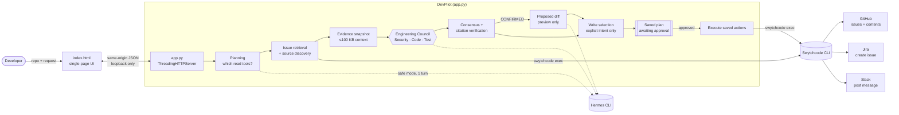

# DevPilot — Autonomous AI Software Engineer

DevPilot is a local web app that investigates a GitHub repository the way an engineer would. You give it a repository and a request in plain English. It reads the open issues and the relevant source files, has three independent AI reviewers check a finding against the code it actually retrieved, and proposes a fix as a reviewable unified diff. If you ask it to, and only after you approve the exact payloads, it files a Jira ticket and posts to Slack.

- **Hermes** does the reasoning: planning, the three code reviews, and the proposed fix. Every call runs in safe mode with no tools.
- **Swytchcode** makes every provider call (GitHub, Jira, Slack). DevPilot never calls those HTTP APIs itself and stores no provider credentials.
- **DevPilot never modifies a repository.** The diff is a preview; nothing creates branches, applies patches, or opens pull requests.

## Features

- **Issue investigation.** Pages through every open issue (100 per page, up to GitHub's 1,000-result search cap) and classifies each one as `CRITICAL`, `HIGH`, or `NORMAL` from its title and body. It then investigates one issue: the number you name (`#2`, `issue 2`, `issue number 2`, matched exactly) or, if you name none, the most severe open issue.
- **Repository analysis.** If the request asks to analyze, audit, scan, review, inspect, or check the repository and names no issue, DevPilot inspects the source directly. This works even when there are no open issues. It visits up to 25 folders and 1,500 tree entries, skips vendor and build folders, and fetches up to 12 prioritized files. Folders it did not visit and files it did not fetch are recorded and shown, and coverage is reported as partial whenever anything was left out. This is a bounded inspection, not a full security audit.
- **Evidence-checked source.** A file counts as evidence only if its complete UTF-8 text came back. Files that failed, were omitted (GitHub omits files over 1 MB), are binary, or have a size mismatch are listed with the reason.
- **Engineering Council.** Security, Code, and Test reviewers get the same evidence snapshot and each return strict JSON. A finding is `CONFIRMED` only when:
  - at least two reviewers confirm it;
  - none says `FALSE_POSITIVE`;
  - every citation matches the retrieved source exactly (file, line range, and snippet).

  A malformed reply gets one corrective retry, and a mismatched citation gets one correction request. Anything else fails closed as `REVIEW_REQUIRED`.
- **Proposed fix.** For a confirmed finding, Hermes writes a unified diff. DevPilot rejects it if it touches a file that wasn't retrieved, goes past a file's real length, or changes none of the cited files.
- **Explicit write intent.** Jira and Slack actions are selected only when the request asks for them with an action verb and a target ("create a Jira ticket", "notify the team in Slack"). A negation cancels its whole clause, and questions or discussion ("explain how…") select nothing. Hermes's planning output can't add a write. There are three kinds of write:
  - **Jira ticket:** exactly one per run, and only for the confirmed finding. In a bulk request, the other matching issues are listed as blocked, with the reason.
  - **Slack finding alert:** sent only for a confirmed finding, and withheld if the planned Jira ticket fails.
  - **Slack run-status notification:** reports how the run actually ended (confirmed, blocked, insufficient evidence, or failed) and its coverage. It is available even when a run fails.
- **Human approval.** The exact Jira payload and Slack text are saved and shown in full. Nothing is sent until you approve that saved plan, and approval runs it exactly as saved. A plan can be approved at most once, expires after 15 minutes, and can be cancelled before it runs.
- **Live activity view.** The single-page UI polls the server and shows each step as it runs: planning, issue search, repository discovery, each reviewer, consensus, the proposed fix, and the writes.
- **Locked-down local server.** The server listens only on loopback addresses, checks the `Host` header to block DNS rebinding, refuses cross-origin requests, and enforces strict request limits. It redacts secrets from error text and keeps raw provider data out of the browser.

## Architecture



A static diagram is also included at [`docs/architecture.png`](docs/architecture.png).

### Request flow

1. **Plan** (`POST /api/plan`). The server validates the inputs. One strict-JSON Hermes call then decides which read tools the request needs (`github`, `repository`). The plan is stored in memory under a random token.
2. **Run** (`POST /api/execute`). A background thread runs these steps:
   1. Retrieves the issues.
   2. Picks the mode (issue or repository) and the target issue.
   3. Walks a bounded part of the repository tree and fetches the source.
   4. Builds one evidence snapshot.
   5. Runs the three reviewers and computes consensus.
   6. For a confirmed finding, asks for the proposed fix.
3. **Poll** (`GET /api/status`, `GET /api/result`). The UI shows live steps and then the final result: council verdicts, the finding, the diff, the inspection scope, and any approval panel.
4. **Approve or cancel** (`POST /api/confirm`, `POST /api/cancel`). Approval runs the saved Jira and Slack actions exactly as shown, without re-running the council.

### Swytchcode methods used

These must be enabled in the project's Swytchcode tooling:

| Canonical ID | Purpose |
|---|---|
| `github.issue.list1` | Search open issues (`GET /search/issues`), paged |
| `github.content.get` | Read the repository tree and file contents (read-only) |
| `jira.api.issue.create` | Create the Jira ticket |
| `slack.chat.postmessage.create` | Post the Slack alert or status message |

### Reviewer context budget

Hermes receives its prompt as one command-line argument, and Linux caps that at 128 KiB. Reviewer and proposal context is therefore valid JSON of at most 100,000 bytes, split into per-section budgets:

| Section | Budget (bytes) |
|---|---|
| Request | 4,000 |
| Target issue | 8,000 |
| Source files | 70,000 |
| Repository root listing | 5,000 |
| Other open issues | 5,000 |
| Inspection scope | 2,000 |

Issue text may be shortened, and is flagged when it is. Source files are included whole or omitted with a reason; they are never cut.

### Plan lifecycle

`planned → running → awaiting_approval → executing → done`, or `cancelled`.

- Approval and cancellation take the same lock, so a plan has exactly one winner.
- Approving after the 15-minute expiry returns `410`.
- After an hour, finished runs and expired plans are removed from memory, and at most 200 finished runs are kept. Active and still-approvable plans are never removed.

## Tech stack

| Layer | Technology |
|---|---|
| Backend | Python 3.10+ standard library only (`http.server`, `threading`, `subprocess`, `json`, `re`) |
| Frontend | One `index.html` file with plain HTML, CSS, and JavaScript. No framework, build step, or external resources |
| AI reasoning | Hermes CLI (`hermes chat --oneshot --safe-mode --max-turns 1`) |
| Provider execution | Swytchcode CLI (`swytchcode exec <canonical_id> --json`) |
| Integrations | GitHub, Jira, and Slack, all through Swytchcode |
| Tests | `unittest` (backend) and Node.js built-ins (frontend); no third-party packages |

## Project structure

```
.
├── app.py                 # HTTP server, orchestration, Engineering Council, Hermes and Swytchcode adapters
├── index.html             # Single-page UI (served at /, strict Content-Security-Policy)
├── test_app.py            # Backend unit tests; every Hermes and Swytchcode call is mocked
├── tests/
│   ├── make_fixtures.py   # Generates UI fixtures by running the real backend against mocked providers
│   └── ui_check.js        # Runs index.html's script in a stub DOM against those fixtures
├── docs/
│   └── architecture.png   # Architecture diagram
├── AGENTS.md              # Swytchcode agent contract for AI coding assistants working on this repo
└── .gitignore
```

## Setup

### Requirements

- **Python 3.10 or later** (tested with 3.12). No `pip install` is needed.
- **Hermes CLI** with a configured model.
- **Swytchcode CLI**, logged in, with the four methods above enabled for this project.
- **Node.js 18 or later**, only for running the frontend checks (tested with 24). No `npm install` is needed.

### Swytchcode

Run these steps from the repository root:

```bash
swytchcode login
swytchcode get github
swytchcode get jira
swytchcode get slack
swytchcode add method github.issue.list1
swytchcode add method github.content.get
swytchcode add method jira.api.issue.create
swytchcode add method slack.chat.postmessage.create
swytchcode list tooling          # confirm all four are listed

swytchcode auth connect github
swytchcode auth connect jira
swytchcode auth connect slack
```

Swytchcode stores the credentials and adds them to each call. DevPilot never reads them. If a call fails with category `auth`, the UI shows the matching `swytchcode auth connect <provider>` command.

The `.swytchcode/` directory holds machine-local workspace state and cached provider bundles. It is gitignored, so each developer sets it up with the commands above.

### Environment variables

| Variable | Required | Purpose |
|---|---|---|
| `DEVPILOT_HERMES_MODEL` | Yes | Hermes model for every call. Every Hermes call is blocked if this isn't set. |
| `DEVPILOT_HERMES_PLANNING_REASONING` | No | Reasoning level for the planning call |
| `DEVPILOT_HERMES_REVIEW_REASONING` | No | Reasoning level for the reviewers and the proposed fix |
| `DEVPILOT_JIRA_BASE_URL` | No | Jira site URL, used only to build `…/browse/KEY` links |
| `DEVPILOT_HOST` | No | Bind address; must be a loopback address |
| `DEVPILOT_PORT` | No | Port to listen on |

## Usage

Start the server:

```bash
python3 app.py
```

Then open the printed URL. By default this is http://127.0.0.1:8765.

Fill in the form:

- **GitHub repository**: `OWNER/REPO`
- **Jira project key**: only needed for Jira actions (2–20 letters, digits, or underscores)
- **Slack channel**: only needed for Slack actions (a channel name such as `#engineering`, or a channel ID)
- **Request**: what you want DevPilot to do, in plain English

Example requests:

| Request | What happens |
|---|---|
| `Investigate the bug in issue #12` | Read-only: reviews issue #12 against the source. Nothing is written. |
| `Analyze the repository for security problems` | Read-only repository analysis with an inspection-scope report |
| `Create a Jira ticket for issue #12 and notify the team in Slack` | Review, then an approval panel showing the exact ticket and message |
| `Audit the codebase and send a Slack status notification when the analysis completes` | Repository analysis, then a run-status message after approval |
| `Investigate issue #12 but do not create Jira tickets or send Slack messages` | The negation applies to both actions, so nothing is written |

### HTTP API

All endpoints are same-origin JSON on the loopback interface:

| Endpoint | Purpose |
|---|---|
| `GET /` | The UI |
| `GET /api/health` | Health check |
| `POST /api/plan` | `{repo, request, jira_project?, slack_channel?}` → plan and token |
| `POST /api/execute` | `{token}` → starts the background review (`202`) |
| `GET /api/status?token=` | Live steps, plus `terminal` and `result_ready` |
| `GET /api/result?token=` | Final result, including the plan's `state`, `expires_at`, `approvable`, and `cancellable` |
| `POST /api/confirm` | `{token}` → runs the approved saved plan |
| `POST /api/cancel` | `{token}` → cancels a plan that hasn't started or is awaiting approval |

### Tests

Both suites run offline. Every Hermes, Swytchcode, GitHub, Jira, and Slack interaction is mocked, and any unmocked subprocess call fails the test.

```bash
python3 -m unittest -v test_app   # backend: 164 tests
node tests/ui_check.js            # frontend: 32 scenarios against backend-generated fixtures
```

### Security notes

DevPilot has **no user authentication**. It is designed as a single-user tool on your own machine:

- The server refuses to start on a non-loopback `DEVPILOT_HOST`.
- Requests with a non-loopback `Host` header are refused with `421`. Cross-origin requests and cross-site `Sec-Fetch-Site` values are refused with `403`.
- POST bodies must be `application/json` and at most 64 KiB, with a valid `Content-Length`.
- Plan tokens must be exactly 32 lowercase hex characters.
- Error text from Swytchcode and Hermes is redacted (Bearer/Basic tokens, `key=value` secrets, Slack and GitHub token formats). Response bodies from failed provider calls are never returned, and requests are not logged.

### Limitations

- **One finding per run.** Bulk requests list the other matching issues as blocked; run DevPilot again for each of them.
- **Repository analysis needs agreement.** If the three reviewers each cite a different problem, their evidence doesn't overlap and consensus is blocked. This is reported, never overridden.
- **Diffs are previews only.** DevPilot doesn't run the target repository's tests.
- **Writes aren't read back.** Jira and Slack results are reported as Swytchcode returned them.
- **State is in memory only** and is lost when the server restarts.
- **Write intent comes from English patterns.** A request in another language may not trigger a write. Approval is always required regardless.

## Roadmap

These are not implemented yet:

- Opening a branch and pull request from an approved diff
- Reviewing several issues per run, so bulk escalation can ticket each reviewed issue
- Running the target repository's tests against the proposed fix
- Reading back created Jira tickets and Slack messages to confirm them
- Persistent plan and run storage that survives restarts
- Authentication, for use beyond a single loopback user

## License

This repository doesn't include a license file yet, so all rights are reserved by the author by default. Add a `LICENSE` file before others reuse or redistribute the code.
